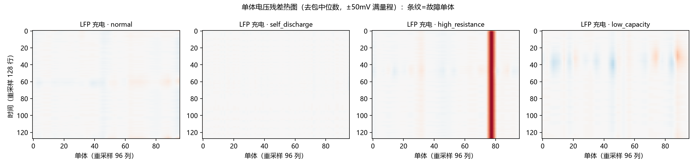

<div align="center">

# 车端电池故障诊断：内短路 / 过放电识别与告警（A1）
### 从电压/温度数据区分健康 / 过放电 / 内短路——递进式分类 + 告警阈值 + 诊断小工具

[](LICENSE)


<p align="center">
  
</p>

</div>

---

实车 BMS 安全告警落地项目：从电压/温度时序区分**健康(0) / 过放电(1) / 内短路(2)**（CH 侧扩展为 4 类），
产出递进式分类（RF → XGBoost → 膨胀卷积 dcnn64 → 曲线融合 CNN）+ 分位数告警阈值设计 + 故障单体定位/分级 +
可直接运行的诊断小工具。

**先看这 5 件事：**

1. **dcnn64（64 步膨胀因果卷积）登顶**：P2 时序口径 **100%**（36/36 窗）/ P1 99.1%——感受野 31 步覆盖完整趋势段后，深度模型在仿真数据上也赢（报告 §4）
2. **树模型不能外推，PSI 把根因量化**：XGBoost P2 过放电召回跌至 0.677；输入漂移 PSI P1 max 0.04 vs P2 max **4.23**——车端部署树模型必须挂 PSI 监控（>0.25 回退规则层）（§4）
3. **跨段车级聚合放大持续性故障信号**：自放电召回 0.83 → **0.875**；全曲线热图⊕数值融合 CNN 段级 **0.884** 登顶并修复 normal 召回（0.47→0.79–0.87）（§6）
4. **故障单体定位与分级解锁**（faults.details.xlsx）：放电最深单体画像对高内阻定位 **100%** / 自放电 74.4%；轻度自放电"检测难、定位易"（§6.5）
5. **告警系统定型**：分位数包络 + 物理硬规则兜底 + 持久/冷却事件化；主库误报 0.47%、双故障 100% 检出（延迟 2/81 步）（§5）

---

## 数据

| 数据集 | 角色 | 许可 | 位置 |
|---|---|---|---|
| Mendeley《EV Lithium Ion Battery Fault Diagnosis Dataset》(t42ynjk936) | 主数据集：三类标签训练/评测 | CC BY 4.0 | `D:\项目\02_数据集\01_国际公开集\EV_FaultDiag_Mendeley\` |
| CH-BatteryGen V1.0（中汽研×华为，ICLR 2026 BatteryFault） | 跨数据集验证：1000 车 / 4 类故障 | CC BY-NC-SA 4.0 | `D:\项目\02_数据集\02_国内公开集\CH-BatteryGen\` |

评测协议对齐 ICLR 2026 BatteryFault 论文：segment 级分层 8:2 + 严格轨迹/车级分组划分（防泄漏），
指标 Accuracy / per-class Recall / 加权 F1 / 混淆矩阵；P1=随机划分（乐观界）/ P2=时序分块（保守）双口径齐报。

## Results

**Mendeley 三分类**（`results/metrics/classical_*_P*.json`）：

| 模型 | P1 随机 Acc / wF1 | P2 时序 Acc / wF1 | P2 过放电召回 | P2 短路召回 |
|---|---|---|---|---|
| XGBoost | 0.996 / 0.996 | 0.899 / 0.894 | **0.677** | 1.000 |
| Random Forest | 0.991 / 0.991 | 0.986 / 0.985 | 0.954 | 1.000 |
| CNN16（窗 16） | 0.982 / 0.982 | 0.917 / 0.917 | 0.769 | 1.000 |
| **dcnn64（窗 64，d=1/2/4/8）** | **0.991 / 0.991** | **1.000 / 1.000** | 1.000 | 1.000 |

**CH-BatteryGen 跨库 4 类**（`results/metrics/chbatterygen_*.json`）：车级 RF 0.804 / 0.799，
自放电召回 **0.875**；曲线融合 CNN（残差热图 ⊕ 形状描述子）段级 **0.884** 登顶。

**残差热图是物理可解释的**（首页图，`results/figures/fig07_残差热图.png`）：高内阻 = 教科书式红色条带
（固定 ±50 mV 物理尺度），正常几乎全平——无监督告警对轻度自放电不可行，但有监督融合模型能学
（轻度自放电检测 25% vs 重度 75%，§6.5）。

**告警设计**（`results/metrics/alarm_design.json`）：健康全包络分位数定标（0.995）+ 持久 3 步 / 冷却 10 步
事件化 + 物理硬规则兜底（含 B1 析锂前兆 `ALM_B1_OCV_DRIFT`，默认关闭）。主库步级误报 **0.47%**。

## Quick start

```bash
git clone https://github.com/ilo-love7/battery-fault-diagnosis.git
cd battery-fault-diagnosis
# venv：D:\项目\venvs\flsoh-py312（Python 3.12，sklearn/xgboost/torch-cpu/pandas）
python -m pytest tests/ -q       # 35 项通过

# 诊断小工具（单段 / 多段车级）
python tools/diagnostic_tool.py --demo
python tools/diagnostic_tool.py --input seg1.csv seg2.csv --chem LFP
# 输出：逐点判别 + 主导判别 + 告警事件时间线；多段追加跨段车级诊断
```

结论在 `reports/基准评测报告-A1.md`（§7 综合结论），局限性诚实声明在 §9。

## Bring your own data

两种输入流自动识别：Mendeley 三特征流（t/v/T 逐点 CSV）或 CH 包级流（xlsx，含 faults.details）。
换数据只需保证三列电压/温度/时间（或步序）；告警阈值按你的健康数据分位数重新定标
（`configs/config.yaml` → `alarm.quantile`）。温度通道若带小时级时间列 `t_h`，可打开 B1 析锂前兆规则。

## How it works

1. **特征**（`src/evfd/data/`）：12 维因果特征（含 d_soc 等趋势量）+ 全曲线残差热图（去包中位数）
2. **递进分类**（`src/evfd/models/`）：RF/XGB 树模型 → cnn16/dcnn64/lstm64 深度模型 → CurveFusionNet（热图 CNN ⊕ 形状分支）
3. **漂移监控**（`src/evfd/evaluate/drift.py`）：PSI 输入漂移，>0.25 触发回退规则层
4. **告警**（`src/evfd/alarm/`）：分位数包络 + 物理硬规则（含 `b1_bridge.py` 析锂前兆桥接）+ 持久/冷却事件化 + 两级结构（步级快告警 + 段级一致性）
5. **明细能力**（`scripts/07`）：故障单体定位（放电最深单体画像）+ 故障分级（轻/中/重）+ 严重度分层

**B1 接口**（析锂前兆）：45 ℃ 静置 7 天 OCV 漂移 → `ALM_B1_OCV_DRIFT`（阈值 −1.425 mV = 标称 −1.781 的 80%），
温度按 Arrhenius 归一（Ea/R=6600 K）后比阈值。规格 `configs/b1_precursor_spec.json` 由 B1 侧生成，
**勿手改**（md5 一致性是验收条件）。默认关闭：现有数据集无 ≥7 天静置段，`applicable()` 会拦住并不产生 NaN 列。

## Reproduce

```bash
# v1.0–v1.1 主线（EDA → 经典模型+PSI → 深度模型 → 告警设计 → 跨库验证）
python scripts/01_eda.py && python scripts/02_train_classical.py && \
python scripts/03_train_deep.py && python scripts/04_alarm_design.py && \
python scripts/05_chbatterygen_eval.py

# v1.2 曲线融合（残差热图 + 形状描述子 + CurveFusionNet）
python scripts/06_curve_cnn.py

# v1.3 故障明细（单体定位 / 分级 / 严重度分层）
python scripts/07_fault_details.py

# v1.4 B1 析锂前兆桥接（默认关闭，零侵入验证见报告 §8）
```

## Layout

```
configs/          config.yaml（路径/告警阈值）；b1_precursor_spec.json（B1 规格，只读）
src/evfd/         核心包：data / models / alarm（含 b1_bridge）/ evaluate
scripts/          01–07 分析流水线
tools/            diagnostic_tool.py 诊断小工具（CLI）
tests/            单元测试 35 项
reports/          基准评测报告（结论与局限声明）
results/metrics/  指标 JSON 出处；results/figures/ 全量图（15 张）
docs/figures/     README 展示用精选图
```

## 边界与负结果

1. **Mendeley 是 MATLAB 仿真、每类单条轨迹**：P1 指标是分布内乐观界；dcnn64 的 P2 测试窗仅 36 个；"温度 58394 K"是仿真失稳特征非物理量
2. **CH-BatteryGen 是机理约束 AI 生成**（真实车标定）：验证告警逻辑跨分布稳健性，非实测验证
3. **自放电统计特征路线到顶**："自放电=静态偏移"（含波动率/残差条带三种表示）均证伪（§6.3）——轻度自放电无监督告警不可行，需全曲线形状特征
4. **分级对重度档召回弱**（18 辆重车判对 3 辆）、低容量定位 0%："轻度故障偏离仅几 mV"的表示边界，需故障值回归
5. **延迟以步计**（无统一物理时间轴）：实车换算需按采样率（CH 10 s/步）

## Going deeper

<details>
<summary>v1.1–v1.4 · dcnn64 登顶 / PSI 漂移监控 / 曲线融合 CNN / 故障明细 / B1 桥接</summary>

v1.1：dcnn64 P2 100% 登顶；PSI 量化树模型外推失效（0.04 vs 4.23）；车级聚合自放电召回 0.875；
"自放电静态偏移"与"按串数定标"两假设证伪留档（§6.3）。
v1.2：残差热图 + SOC 对齐形状描述子 + CurveFusionNet 段级 0.884 登顶（§6.4）。
v1.3：故障单体定位（高内阻 100%/自放电 74.4%，实证 xlsx cell id 0-based）、分级 0.58 vs 基线 0.52、
严重度分层（高内阻轻度即 100%）（§6.5）。
v1.4：B1 析锂前兆桥接（默认关闭零侵入，测试 13→35）。

</details>

## Citation & licence

```bibtex
@software{battery_fault_diagnosis_2026,
  author = {ilo-love7},
  title  = {车端电池故障诊断：内短路/过放电识别与告警（A1）},
  year   = {2026},
  url    = {https://github.com/ilo-love7/battery-fault-diagnosis}
}
```

MIT License · 数据集许可见各数据集原文（Mendeley CC BY 4.0 / CH-BatteryGen CC BY-NC-SA 4.0）。
